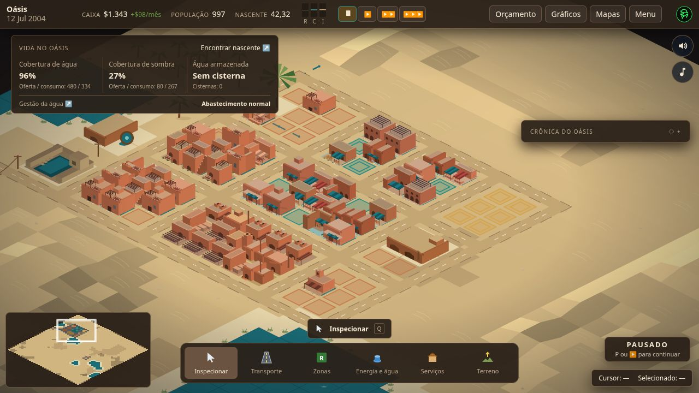
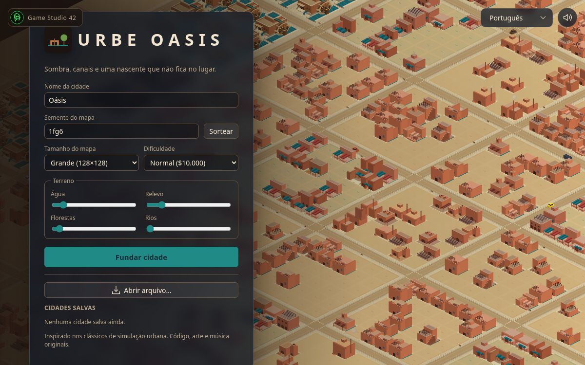
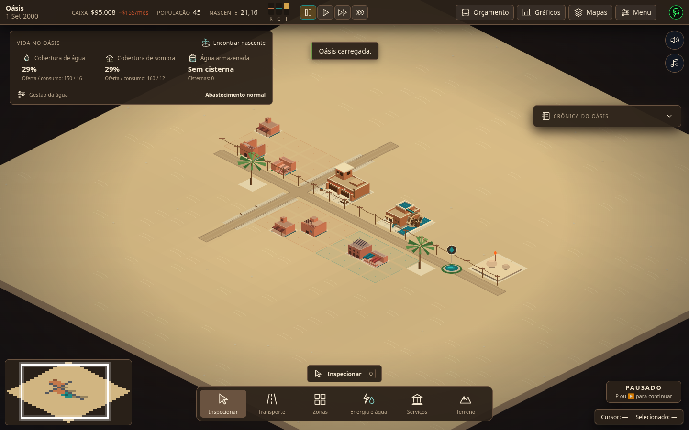
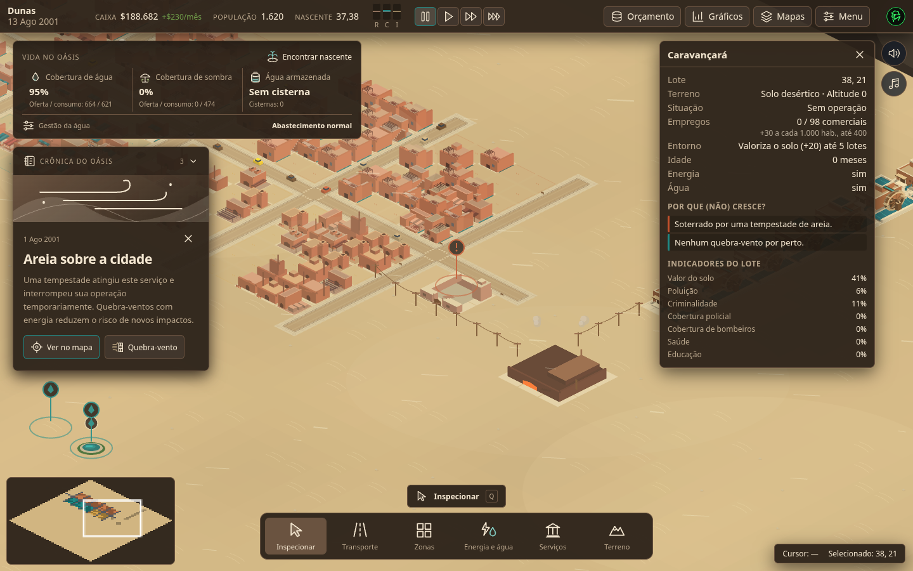

<p align="center">
  
</p>

<h1 align="center">Urbe Oasis</h1>

<p align="center"><strong>Build around the spring. Help a desert city endure.</strong></p>

<p align="center">
  <a href="https://gamestudio42.github.io/urbe-oasis/"></a>
  <a href="https://github.com/gamestudio42/urbe-oasis/actions/workflows/deploy.yml"></a>
  <a href="https://github.com/gamestudio42/urbe-oasis/stargazers"></a>
  <a href="https://github.com/gamestudio42"></a>
</p>

<p align="center">
  An isometric city builder for the browser. Lay roads, zones, water and shade; the simulation
  decides which lots grow, which services fail and who remains. Found a settlement beside a
  wandering spring, then keep it alive through drought, sandstorms and a changing economy.
  No installation is needed to play.
</p>

<p align="center">
  <a href="https://gamestudio42.github.io/urbe-oasis/">
    
  </a>
</p>

<p align="center">
  <a href="https://gamestudio42.github.io/urbe-oasis/">
    
  </a>
</p>

## A city shaped by survival

1. **Find the spring.** Your first city opens paused, centred on its water source. A ten-step
   tutorial guides you through the first road, homes, jobs, power, water, shade and cistern.
2. **Create the conditions.** Zone land and connect networks. Canals and palms bring shade;
   qanats, pumps and cisterns help keep water available. The simulation determines growth.
3. **Read the city.** The survival panel shows water, shade and stored water. Inspect a lot to
   see what holds it back; use maps, charts and the budget to decide what to change.
4. **Adapt.** The spring moves. Caravans trade with viable districts. Sandstorms can bury a
   service, while windbreaks lower the risk. Water rationing can ease a shortage at a cost.

Lots without both water and shade cannot develop beyond level 2. A spring house is strongest
near the spring and on the water network; a wild palm is scenery, while a planted palm supplies
shade. These are simulation rules, not just visual effects.

## See the oasis

<p align="center">
  
</p>

<table>
<tr>
<td align="center" width="50%" valign="top">
<br>
Build around the spring and connect the first services.
</td>
<td align="center" width="50%" valign="top">
<br>
Follow a sandstorm in the chronicle and inspect its impact.
</td>
</tr>
</table>

## Play

Open **[gamestudio42.github.io/urbe-oasis](https://gamestudio42.github.io/urbe-oasis/)**.
Choose a seed, map size and difficulty, then found your oasis. The first visit follows your
browser language; the interface supports English, Portuguese, Spanish, French and German.

| Action                                   | Shortcut    |
| ---------------------------------------- | ----------- |
| Inspect / road                           | `Q` / `R`   |
| Zones / remove zone                      | `1–6` / `0` |
| Power / water                            | `E` / `T`   |
| Pause / sound                            | `P` / `M`   |
| Underground / grid                       | `U` / `G`   |
| Cancel the current tool or close a panel | `Esc`       |

The Menu lists all shortcuts. Cities autosave in the browser; you can also export and import
`.oasis.json` files to keep a portable copy.

## Develop

Requires Node.js 22+ and pnpm 10.

```sh
pnpm install
pnpm dev        # http://localhost:5180
```

Docker is also available with `docker compose up`.

| Command           | Purpose                                                     |
| ----------------- | ----------------------------------------------------------- |
| `pnpm check`      | Lint, type check, unit and scenario tests, production build |
| `pnpm test:e2e`   | Playwright browser tests                                    |
| `pnpm sim --list` | List headless simulation presets                            |
| `pnpm bench`      | Measure simulation tick times                               |

Every push to `main` builds `apps/oasis/dist` for GitHub Pages. A different deployment path can
be set with `BASE_PATH=/your-path/ pnpm build`.

The simulation is deterministic and runs in a Web Worker. React sends commands and reads the
world; the renderer draws it with the Oasis theme. The classic city ruleset remains separate.
See the [architecture](docs/architecture.md), [Oasis rules](docs/oasis-spec.md),
[simulation spec](docs/simulation-spec.md), [balancing](docs/balancing.md),
[roadmap](docs/roadmap.md) and [contribution guide](CONTRIBUTING.md).

## Licence

Urbe Oasis is MIT-licensed. Its code, procedural art, sound and music are original.
Micropolis and OpenSC2K were studied as behavioural references only; no code or assets were
copied. See [LICENSE](LICENSE) and [AGENTS.md](AGENTS.md) for project rules.
