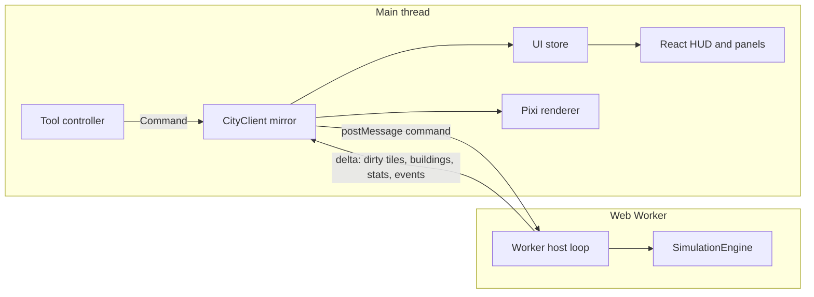

# Architecture

This repository is **Urbe Oasis**, a desert isometric city builder. There is no backend:
the game runs in the browser, and saves live in IndexedDB or in exported files.

`apps/oasis` is the game the player opens. It boots the shared city UI in `apps/web` with
the adobe theme, the oasis ruleset and its own soundtrack. The classic ruleset stays in the
simulation so oasis mechanics remain a gated layer; new cities from the menu are oasis.

## Packages

| Package               | Responsibility                                                         | May depend on                      |
| --------------------- | ---------------------------------------------------------------------- | ---------------------------------- |
| `packages/kernel`     | RNG, hash, base64, save envelope, command queue, tick runner           | nothing                            |
| `packages/bridge`     | Worker clock and RPC inbox                                             | nothing                            |
| `packages/view-iso`   | Isometric projection, camera, 16×16 chunk grid                         | pixi.js                            |
| `packages/chrome`     | Store, boot/pause/toasts, Logo, SoundToggle, SfxBoard, locale, saves   | react                              |
| `packages/shared`     | City tile constants, commands, balance, save schema                    | `@shell/kernel`                    |
| `packages/simulation` | City engine: world, systems, commands, persistence, scenarios          | `@city/shared`, `@shell/kernel`    |
| `packages/theme`      | Colourless `Theme` interface injected into the renderer                | nothing                            |
| `packages/theme-urbe` | Classic palette, kept so the renderer can still draw that ruleset      | `@theme/core`                      |
| `packages/theme-neon` | Cyberpunk palette kept so the sprite tests still have a cyber skin    | `@theme/core`                      |
| `packages/theme-oasis`| Desert palette, CSS tokens and audio parameters                        | `@theme/core`                      |
| `packages/view-city`  | Pixi renderer, sprites and animation layer, theme injected             | pixi.js + city packages            |
| `apps/web`            | City UI: Vite + React panels, worker host, shared by the oasis shell   | city packages + shell              |
| `apps/oasis`          | Urbe Oasis: adobe theme, oasis ruleset, desert music, port 5180        | view-city + themes + city packages |
| `tools/`              | Headless city reports and the tick benchmark                           | shared, simulation                 |
| `tests/`              | Unit, integration, scenario (Vitest) and end-to-end (Playwright) tests | everything                         |

Packages expose their TypeScript sources directly (`"exports": "./src/index.ts"`). Vite, Vitest
and `tsx` compile them on the fly, so there is no package build step.

## Publish

`pnpm dev` serves Urbe Oasis on port 5180 with `base: '/'`. `pnpm build` writes `apps/oasis/dist`.
GitHub Pages publishes that folder (`BASE_PATH` from the repository name).

New cities use the `oasis-city-save` envelope (`.oasis.json`). The decoder still accepts the
classic `city-builder-save` envelope; the `ruleset` stored in the file decides which rules run.

The simulation package compiles with `lib: ["ES2023"]` and no ambient types, so any accidental
use of DOM or Node APIs fails the type check. ESLint additionally bans `Math.random`, `Date`,
`performance` and the transcendental `Math` functions there (see [determinism](#determinism)).

## Runtime topology

- **SimulationEngine** (`packages/simulation/src/engine.ts`) owns the authoritative state. It is a
  plain class: `enqueue(command)`, `tick()`, `runTicks(n)`, `serialize()`, `Engine.fromSnapshot()`.
- **Worker host** (`apps/web/src/worker/sim.worker.ts`) runs a fixed-step loop. Real elapsed time is
  converted into a whole number of ticks according to the selected speed. The engine never
  sees wall-clock time.
- **CityClient** (`apps/web/src/state/client.ts`) keeps a read-only mirror `World` on the main
  thread. It applies the deltas sent by the worker. Because the mirror is a real `World`,
  the UI can run the same pure validation (`previewCommand`) and diagnostic
  (`diagnoseTile`) functions as the engine, without a round trip.
- **Renderer** (`packages/view-city`) draws the mirror with an injected `Theme`. It never mutates
  simulation state.
- **GameSession** (`apps/web/src/state/session.ts`) wires the client, the renderer and the tools
  to a small `Store<UiState>`: current screen (menu or game), open panel, tutorial step, tool,
  overlay, speed and toasts. React components subscribe to slices of that store.

## User interface

| Element   | Component             | Notes                                                        |
| --------- | --------------------- | ------------------------------------------------------------ |
| Boot      | `ui/BootScreen.tsx`   | Logo, current step and a progress bar until the menu is up   |
| Main menu | `ui/MainMenu.tsx`     | City name, seed, map size, difficulty, terrain sliders       |
| HUD       | `ui/Hud.tsx`          | Date, funds and monthly net, population, RCI bars, speeds    |
| Pause     | `ui/PauseOverlay.tsx` | Vignette and "Pausado" badge; does not block the map         |
| Toolbar   | `ui/Toolbar.tsx`      | Tool groups with hotkeys and cost tooltips                   |
| Minimap   | `ui/Minimap.tsx`      | Isometric diamond, current overlay, view rectangle, recentre |
| Overlays  | `ui/OverlayPanel.tsx` | Twelve thematic maps, plus a shade map in Urbe Oasis        |
| Budget    | `ui/BudgetPanel.tsx`  | Taxes, department funding, monthly ledger, debt warnings     |
| Charts    | `ui/ChartsPanel.tsx`  | Population, money, demand and environment history            |
| Inspector | `ui/Inspector.tsx`    | Tile facts and the "why is it (not) growing" problem list    |
| Tutorial  | `ui/Tutorial.tsx`     | Seven steps, auto-advanced by checks in `state/tutorial.ts`  |
| System    | `ui/SystemPanel.tsx`  | Saves, grid, underground, sound, music, help, back to menu   |

Only one floating panel is open at a time; the inspector stacks above it in the right column.
`Esc` closes the panel first, then cancels the tool and clears the selection.

**Construction feedback.** `ToolController` schedules at most one preview per animation frame,
using the latest tile/drag endpoint and the fully applied mirror delta. `onStats` refreshes the
preview after tile/building updates, including changes to funds, bankruptcy and population
without cursor movement. Planning passes the mirror's ruleset, so Oasis canals use the same
validation as the worker. Previewing never sends a command or changes the simulation.

Pointer release commits its actual tile even if a move or preview frame has not arrived yet.
Releasing outside the map cancels the drag. Pointer cancellation, unexpected capture loss and
window blur clear the gesture and queued preview; ordinary capture loss after pointer-up does
not undo a completed command. The renderer tracks one active pointer, so another pointer cannot
finish that gesture. Tool switches, city replacement and disposal also discard pending previews.
Unit tests cover coalescing, ruleset parity, affordability, release endpoints and cancellation;
browser tests exercise actual canal placement, stationary affordability updates and recovery
after interrupted gestures. This bounds preview work; it is not a renderer frame-rate guarantee.

**Boot and menu background.** `index.html` carries a static splash (logo and "Carregando…")
inside `#root`, so something shows before the bundle runs; React replaces it with the boot
screen, which looks the same plus a step label and a progress bar. `GameSession.boot()` goes
through `UiState.boot.step`: `graphics` (Pixi init), then `city`, where the worker builds the
menu city (`demoCity` message: the `grid` preset on a 64×64 map, `urbe-menu` seed, 60 months
simulated up front with the preset's automated player, `demoProgress` every 6 months; about
0.7 s in the worker), then `done`. The menu mounts only at `done`, and a failure in either step
still ends there (the menu then has no city behind it). The boot screen fades out in 300 ms
(instantly with reduced motion).

Behind the translucent menu card the renderer runs in attract mode (`setAttract`): keyboard
panning is ignored and the camera drifts around the map centre on a slow loop (150 s, zoom
0.9), shifted right of the card; it stands still with reduced motion. The background city keeps
simulating at normal speed, but its events never produce toasts or sounds (`announce()` only
runs on the game screen). Going back to the menu keeps the player's city behind it, paused,
with its animations running.

## World representation

The map is a square grid (`size × size`, 128 by default) stored as a structure of arrays:

| Layer                                        | Type         | Meaning                                                                                          |
| -------------------------------------------- | ------------ | ------------------------------------------------------------------------------------------------ |
| `heights`                                    | `Uint8Array` | Vertex heights, `(size + 1)²`, corners of tiles                                                  |
| `terrain`                                    | `Uint8Array` | `Terrain` enum (water, sand, grass, dirt, rock)                                                  |
| `trees`                                      | `Uint8Array` | Vegetation density 0..3                                                                          |
| `zone`, `zoneDensity`                        | `Uint8Array` | Zone type and light/dense                                                                        |
| `infra`                                      | `Uint8Array` | Bit flags: road, power line, water pipe, rubble, fiber (16). Fiber stays unset in a classic city |
| `buildingId`                                 | `Int32Array` | Building occupying the tile, `0` = none                                                          |
| `powered`, `watered`                         | `Uint8Array` | Utility service flags                                                                            |
| `linked`                                     | `Uint8Array` | Oasis shade. Not a structure layer, and omitted from a classic snapshot                         |
| `fire`                                       | `Uint8Array` | Fire intensity, `0` = not burning                                                                |
| `pollution`, `crime`, `landValue`            | `Uint8Array` | Influence maps, 0..255                                                                           |
| `traffic`, `jobAccess`                       | `Uint8Array` | Aggregated traffic load and job accessibility                                                    |
| `police`, `fireCover`, `health`, `education` | `Uint8Array` | Service coverage, 0..255                                                                         |

Tile index: `i = y * size + x`. The `Tile` interface in `@city/shared` is only a read-only
view (`world.getTile(x, y)`), used by tests and the info panel.

Buildings are records in a `Map<number, Building>`. Insertion order is stable, so iteration is
deterministic. Zone buildings occupy one tile; placed buildings (plants, services) have a
footprint of `w × h` tiles.

## Simulation clock

| Unit  | Value               | Systems                                                               |
| ----- | ------------------- | --------------------------------------------------------------------- |
| Tick  | 1/4 day             | Fires, active disasters, command application                          |
| Day   | 4 ticks             | Network rebuilds (power, water, and oasis shade) when dirty           |
| Month | 30 days = 120 ticks | Traffic, services, influence (last 3 ticks), then demand, growth, tax |
| Year  | 12 months           | Yearly statistics, evaluation                                         |

Speeds: paused, 1× (20 ticks/s, one month every 6 s), 2× and 4×. The worker accumulates
real time and runs a whole number of ticks per frame, capped to avoid a spiral of death.

## Tick pipeline

Each `step()` runs, in order:

1. Apply queued commands (recorded with their tick number for replay).
2. At the start of a day, rebuild the power and water networks if they are dirty. An oasis city
   rebuilds the shade network in the same pass, after water.
3. Advance fires and disasters, then custom systems.
4. Advance the tick counter and run the month stage of the new tick, if any: traffic and job
   accessibility (tick 117 of the month), service coverage (118), influence maps (119), and the
   close (0) with demand, growth, budget, history, yearly events and random disasters.
5. Publish: the worker sends the dirty tiles and buildings as the next delta.

Spreading the month over four ticks bounds the worst tick by the heaviest stage instead of the
sum of all of them: on a 128×128 city with 32 000 residents the month costs about 28 ms in
total, and the p95 of every tick stays under 10 ms even on a CPU throttled to 400 MHz
(measurements in `docs/balancing.md`).

Systems implement `System { id; update(ctx: SimContext): void }` and are registered in a fixed
order. The engine only orchestrates; game rules live in the systems.

## Rulesets

`EngineOptions.ruleset` selects `'classic'` (Urbe, default) or `'oasis'` (Urbe Oasis). The flag is
stored in the snapshot and in the save, so a loaded city keeps its own rules regardless of the app
that opened it. The classic path is untouched: every oasis branch is guarded by
`ruleset === 'oasis'`, and the classic unit, scenario and E2E suites keep the same hashes.

| Area     | Classic                 | Oasis                                                                    |
| -------- | ----------------------- | ------------------------------------------------------------------------ |
| Water    | Component balance       | Same components, plus evaporation, cisterns, qanats and parched districts |
| Shade    | No shade network        | Canals, palms and spring houses. A lot without shade or water stops at 2 |
| Land     | Vacant lots stay vacant | Four caravans buy watered or shaded lots while a caravanserai is open   |
| Storms   | No sandstorms           | A monthly storm buries a service; a powered windbreak can block it      |
| Traffic  | Ground network only     | An arcade eases congestion. The adobe theme does not draw drones         |
| Zoning   | Classic level caps      | Dense level 5 and light level 2 when the lot has water and shade         |

The oasis systems live in `packages/simulation/src/systems/oasis/` (the shade pass itself stays in
`systems/utilities.ts`, beside power and water); their constants are in
`packages/shared/src/balance/oasis.ts` and their formulas in [oasis-spec.md](oasis-spec.md).
`CityStats.oasis` carries the extra telemetry (parched districts, cistern charge, windbreak
coverage, arcades, caravans, trade paid in, shade supply and demand, and the spring) and is
absent in a classic city.

Themes are orthogonal to the ruleset: `@view/city` receives a `Theme` and never hardcodes a colour,
so `apps/web` injects `@theme/urbe` and `apps/oasis` injects `@theme/oasis`. `@theme/neon` stays
in the repo so the cyber sprite tests still have a skin. A further skin is a new
`packages/theme-*` package, not a fork of the renderer.

## Determinism

- A single seeded RNG (`xoshiro128**`) with serializable state. No `Math.random`.
- No wall-clock time inside the engine.
- No transcendental `Math` functions in the engine (their precision is implementation-defined).
  Allowed: `+ - * /`, `Math.sqrt` (correctly rounded by IEEE 754), `floor`, `round`, `min`,
  `max`, `abs`, `imul`, `trunc`.
- Money is kept in whole dollars; fractional revenue is rounded once per month.
- Iteration order is always index order or insertion order.
- `hashState(engine)` (FNV-1a over every layer, building and economy field) is the oracle used by
  determinism and save/load tests.

## Persistence

`engine.serialize()` returns an `EngineSnapshot` (plain data, layers as `Uint8Array`).
`@city/shared` turns it into a versioned `SaveFile` (JSON, layers in base64, FNV checksum) and
validates it on load (format in [the spec](simulation-spec.md#111-save-format)). Migrations are
pure functions registered by version.

Encoding and decoding run in the worker (`exportSave` / `importSave` messages), so a large
city never blocks the UI thread and an invalid file never replaces the running city.

The web app (`apps/web/src/persistence/saves.ts`) stores saves in IndexedDB, database
`city-builder`, with two stores keyed by slot id: `meta` (the small `SaveSlot` records listed
by the menu) and `data` (the save text). Each city has one manual slot (`city:<seed>:<name>`)
plus a shared `autosave` slot, written every minute of real time while the game screen is
open, when the tab is hidden and when the player goes back to the menu. Storage errors are
classified (`quota`, `unavailable`, `missing`) and shown to the player; export to a
`.city.json` file is always available as a fallback. Loaded cities start paused.

## Rendering

- Isometric projection: `screenX = (x - y) · w/2`, `screenY = (x + y) · h/2 - elevation · hₑ`,
  with `w = 64`, `h = 32`, `hₑ = 8` pixels.
- Terrain uses vertex heights, so slopes are drawn as quads with four independent corners.
- The map is split into 16×16 chunks. Each chunk owns, bottom to top, a terrain `Graphics`, a
  water-glint container, an overlay `Graphics`, a vehicle container and an object container
  (building and tree sprites); vehicles and objects are depth-sorted by `x + y`. Chunks are
  ordered by `cx + cy`, so cross-chunk overlap is resolved back to front.
- Only chunks with dirty tiles are redrawn; off-screen chunks are culled.
- Building, tree and vehicle textures are generated procedurally at startup from `Graphics`
  and cached.
- Picking inverts the projection for every candidate elevation and keeps the front-most tile
  whose quad contains the cursor.

## Animations

`packages/view-city/src/animation/` adds motion on top of the chunks. It is purely cosmetic:
it reads the mirror world and never sends commands, so turning it off changes nothing in the
simulation. The rules live in pure modules (unit tested); `AnimationLayer` only maps them to
Pixi sprites.

- **Cars and trucks** (`vehicles.ts`, `roads.ts`) drive on the right-hand lane of the visible
  road tiles. Their number follows the simulated traffic layer:
  `density = min(0.6, 0.15 + 0.9 · traffic / 255)` cars per road tile carrying any traffic
  (none without traffic), at most 250. Congested tiles slow them down
  (`speed · (1 − 0.5 · traffic / 255)`) and junction choices favour busier neighbours and
  going straight on. A car disappears when its road is demolished or it drives out of view.
- **Chimney smoke** (`smoke.ts`) rises from coal and gas plants while online and from working
  industry of level 3 or more (powered, occupied, not abandoned). Chimney positions come from
  `renderer/chimneys.ts`, shared with the building textures, which no longer draw static smoke.
  At most 300 puffs: when the chimneys in view would need more, every chimney emits
  proportionally less (and the first one served rotates each frame), so all of them keep
  smoking. Puffs grow up to 2× when zoomed out (`1/√zoom`) so they stay readable.
- **Water glints** (`water.ts`) flash on a stable third of the open-water tiles; they use real
  time, so they keep shimmering while paused.
- **Fire engines** (`fireDispatch.ts`) leave a station for fires on covered tiles
  (`fireCover > 0`), found by scanning the fire layer and from `fireStarted` events (a well
  covered fire is often out within a few ticks). The route is a road BFS from the tiles around
  the nearest station to a road tile within three tiles of the fire; the truck parks with its
  lights flashing for at least two seconds and while anything burns nearby, then drives back
  and disappears. At most four trucks.

Motion uses game time (`deltaMS × [0, 1, 1.6, 2.2]` for pause and the three speeds), so
everything freezes while paused. Random choices use the layer's own seeded PRNG
(`random.ts`), never the engine RNG. Only visible chunks are animated, cars are hidden below
0.45 zoom and in the underground view, and vehicles and smoke are dimmed while a map overlay is
shown. The toggle in the system panel is stored in `localStorage['cityBuilder.animations']`;
it defaults to off when the system asks for reduced motion. On a 128×128 city the layer costs
about 0.3 ms per frame with ~190 cars (see [balancing.md](balancing.md)).

## Audio

`apps/web/src/audio/sound.ts` synthesizes every sound effect with WebAudio (oscillators and a
noise buffer), so the project ships no audio files. `GameSession` plays a sound when a tool
command succeeds (build, zone, demolish), when one is rejected, and for selected engine events
(fire, destroyed building, disaster, brownout, water shortage, debt, bankruptcy, milestone).
The `AudioContext` is created lazily and resumed on the first pointer or key press, as
browsers require. Each sound is rate-limited to one play per 120 ms. Effects and music have
their own buses into one master gain. Mute silences both; it is toggled in the system panel,
with `M` in game or with the speaker button on the menu, and is stored in
`localStorage['cityBuilder.muted']`.

**Music** is procedural ambient lo-fi, also synthesized. `audio/composer.ts` is pure (unit
tested): `composeBar(track, bar, random)` returns the notes of one 4-beat bar from a seeded
generator, with a rootless electric-piano chord (strummed, sometimes restruck softer), a pad
on root, fifth and third, bass on beats 1 and 3 (root, sometimes the fifth) and a sparse
melody of swung eighths that moves by small steps through the major pentatonic, preferring
chord tones on strong beats (at most 4 notes per bar). Two tracks: `menu` (70 bpm, D major,
I–IV–vi–IV) and `city` (84 bpm, F major, ii–V–I–vi), all ninth chords.

`audio/music.ts` (`MusicPlayer`) schedules whole bars on the audio clock with a lookahead
(200 ms timer, 1.2 s ahead; it restarts from now instead of catching up after a throttled
tab). Voices: two-operator FM electric piano with a short high "tine" on the attack (keys and
melody), two detuned triangles through a lowpass with a slow swell (pad), and a sine plus a
quiet octave triangle (bass). Each voice has its own dry level and sends into a noise-impulse
convolver reverb (2.6 s) and a 0.42 s feedback delay; a very low bandpassed noise loop adds
vinyl hiss. Switching tracks crossfades over 2 s; starting fades in over 2 s. While the game is
paused the music ducks by about 6 dB and its lowpass closes from 5.2 kHz to 1.2 kHz. The
session picks the track from the screen and passes the pause state from `setSpeed`. Music
starts with the first gesture, defaults to on and is stored in
`localStorage['cityBuilder.music']` (system panel checkbox).

## Error handling

- Rejected commands return a `RejectReason` code; the UI translates it to the player's language.
- Save validation reports every problem found; a corrupted file never reaches the engine.
- IndexedDB quota errors and WebGL context loss are surfaced to the player.
